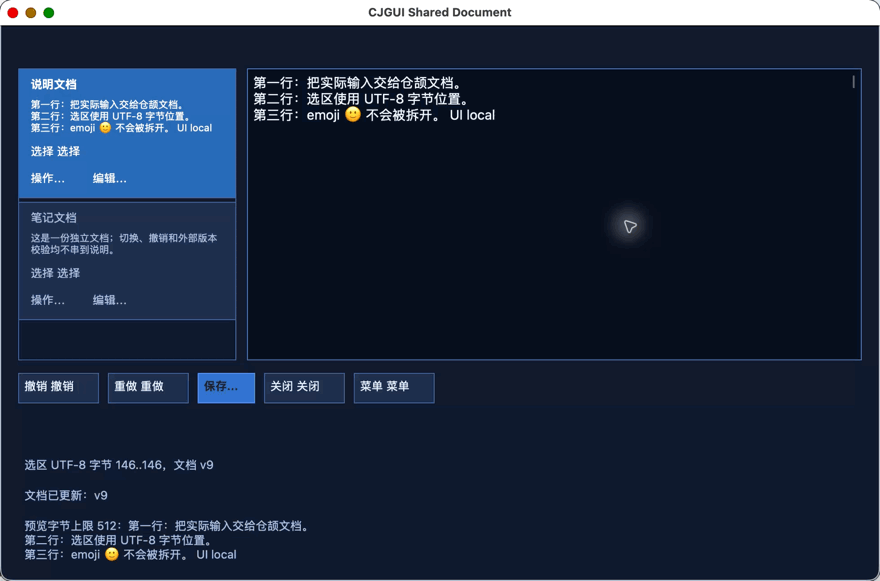

# CJGUI

**用仓颉，构建人和 AI 都能操作的桌面应用。**

CJGUI 是一个以仓颉为核心的自绘 GUI 框架。它提供组件、布局、文字、输入与 GPU 渲染，也让手写界面、运行时生成界面和外部 Agent 共用同一份业务数据与操作。

如果你正在做编辑器、配置工具、数据工作台或 AI 应用，CJGUI 可以帮你减少重复接线：字段、数据和动作定义一次，窗口里的用户与外部工具都能使用。

`macOS 开发预览` · `AppKit / Metal` · `Cangjie 1.1.3` · `Apache-2.0`

## 为什么值得试

- **仓颉自绘，接入系统能力。** 组件、布局和交互由仓颉组织；macOS 后端使用 AppKit、Metal、TextKit / CoreText，并接入输入法、菜单、剪贴板和辅助功能。
- **业务只接一次。** 手写控件、生成控件和 Agent 工具使用相同的字段、数据与业务动作，操作结果回到正在使用的应用。
- **界面可以随任务变化。** 应用可以保留固定主界面，同时开放生成区域，在运行中增加或调整面板，用户随后可以继续操作。
- **面向真实应用。** 表单、虚拟列表、树、多窗口、主题、图片和文档工作会话可以组合使用，视口准备与资源复用为持续交互服务。

Windows 与鸿蒙也在复用同一仓颉核心，相关实践和入口见开发文档。

## 快速开始

准备 macOS / Apple Silicon、仓颉 1.1.3 和 Xcode Command Line Tools。

```sh
git clone https://gitcode.com/aiulms/cjgui.git
cd cjgui
zsh runtime/cjgui/examples/rule_set_window_app/run.sh
```

创建自己的应用也很简单：

```sh
zsh runtime/cjgui/scripts/create_macos_application.sh ui-only /tmp/MyCJGUIApp
zsh /tmp/MyCJGUIApp/run.sh
```

从 `ui-only` 开始编写普通 UI；需要 Agent 共同操作时，可以选择 `collaboration` 或 `mixed-form` 模板。

## 看看实际运行

在窗口里编辑，通过公开接口追加内容，再回到窗口续写：三个步骤修改的是同一份文档。



[观看完整演示](docs/contest/2026-10-07/demo/README.md) · [演示素材说明](docs/assets/demo/README.md)

## 文档

- [开发文档](runtime/cjgui/README.md)：组件、布局、输入、生成界面与渲染。
- [macOS 应用与打包](runtime/cjgui/MACOS_APPLICATION_HOST.md)：模板、构建和应用宿主。
- [共同操作设计](docs/core/AI_NATIVE_UI_SEMANTICS.md)：字段、上下文、动作与授权。
- [开发动态](runtime/cjgui/ACTIVE_DIRECTION.md) · [完整文档目录](docs/README.md) · [协作规则](AGENTS.md)。

## 许可证

[Apache License 2.0](LICENSE) · Copyright 2026 CJGUI contributors · [NOTICE](NOTICE)
