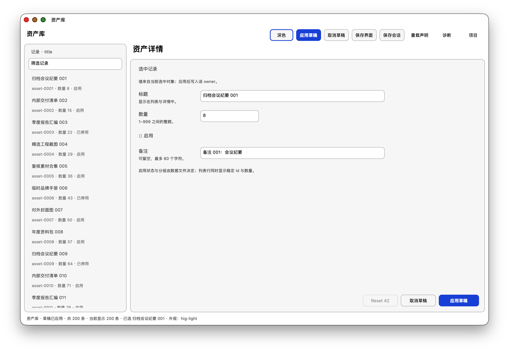
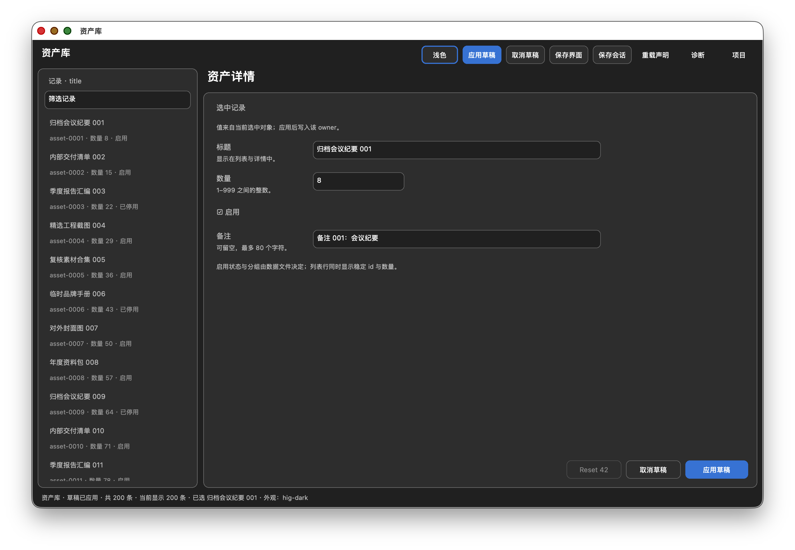

# CJGUI

## 仓颉原生自绘 GUI，人与 AI 共同操作的桌面应用框架

CJGUI 用仓颉实现组件、布局、文字、场景与交互，通过系统窗口、文字服务和 GPU 后端构建桌面应用。手写界面、运行时生成界面和外部 Agent 使用同一份业务数据与操作。

**它不仅让 AI 看懂界面，也让 AI 能在应用运行期间参与构建界面。**

`仓颉原生` · `独立自绘` · `AI 运行时原生` · `macOS / Metal` · `Apache-2.0`


<sub>概念视觉：两个操作者接续操作同一个窗口。下方为 CJGUI 最新真实 macOS 工作区。</sub>

## 最新真实界面

| 亮色工作区 | 暗色工作区 |
| --- | --- |
|  |  |

<sub>自绘列表、表单、工具栏、弹层与主题。字段编辑、草稿应用和外部操作进入同一个业务 owner。</sub>

## 仓颉原生，走一条独立的 GUI 路线

CJGUI 的核心组件、布局、场景与交互由仓颉实现，主渲染链无需 SDL、Qt、Flutter、GPUI 或 WebView。系统 API 提供窗口、文字、输入法和 GPU 能力，框架的组件表达与交互模型则保持在仓颉之中。

这意味着应用得到的不是一层简单窗口封装，而是一套完整的界面基础设施：组件组合、文字排版、命中与焦点、虚拟集合、场景事务、资源生命周期，以及人与 Agent 的共同操作协议。

## 和其他 UI 路线相比，CJGUI 特别在哪里

| 常见路线 | CJGUI 的不同 |
| --- | --- |
| **AppKit / SwiftUI 控件封装** | 保留系统窗口、文字和输入服务，按钮、列表、输入区与弹层由统一仓颉场景自绘；布局、样式和动态生成可以跨应用复用。 |
| **Flutter / Qt** | 应用逻辑与界面核心都落在仓颉，主渲染链不携带这些第三方 GUI 引擎；macOS 直接使用 AppKit 与 Metal。 |
| **GPUI** | 同样采用自绘与 GPU 路线；CJGUI 进一步把字段、动作、业务 owner、运行时生成和 Agent 共同操作纳入框架主模型。 |
| **SDL / 底层图形库** | 提供完整组件、布局、文字、输入、语义和业务绑定，不止于窗口、事件与绘制接口。 |
| **Electron / WebView** | 使用原生可执行程序与 Metal 场景；业务对象和语义直接关联，Agent 可以调用结构化动作，无需把 DOM 或截图坐标作为操作中介。 |

**差异不只是一门实现语言，而是“自绘 GUI + AI 运行时共同操作”这一整套开发模型。**

## 自绘界面，也保留原生体验

macOS 后端将仓颉自绘管线接入系统能力：

| 层次 | CJGUI 的实现 |
| --- | --- |
| 组件与布局 | 仓颉组件树、约束布局、样式、虚拟集合、焦点与事件分发 |
| 文字与输入 | TextKit / CoreText 排版，系统输入法、选区、组合文本和候选窗定位 |
| 窗口与系统服务 | AppKit 窗口、菜单、剪贴板、拖拽、主题、辅助功能 |
| 绘制与合成 | Metal 场景绘制、文字与图片资源复用、效果组与窗口材质 |

同一组布局结果同时用于绘制、命中、焦点和无障碍。自绘负责一致的组件表达，系统服务负责平台体验，两条路径在真实窗口里汇合。

## AI 运行时原生：生成的是可以立即操作的界面

AI 生成代码是一种开发方式；CJGUI 还支持在应用运行期间提交受限界面结构，让它直接成为真实控件。

- **能力可发现**：组件、属性、字段、动作、参数与约束来自应用开放的目录。
- **生成即可操作**：输入框修改真实草稿，按钮调用真实业务动作，生成区与手写区可以同时工作。
- **修改后仍能接续**：稳定 key 帮助控件在重排后保留草稿、选区和焦点。
- **共享业务真相**：人、生成控件和外部 Agent 使用同一字段定义、版本与业务 owner。

因此，“根据当前任务生成一个面板”不需要提前写死页面，也不需要为 AI 再维护一套低配接口。AI 的修改直接发生在用户正在使用的应用里。

## 为持续交互而设计

- **视口虚拟化**：长列表、树和卡片网格只准备附近内容。
- **文字与图片复用**：排版、文字纹理和图片按内容身份与版本复用。
- **有界场景准备**：复杂场景分步准备，提交时保持布局、输入与版本一致。
- **资源生命周期**：候选、接受、取消和关闭分别处理，绘制资源跟随真实场景代次。
- **统一诊断**：场景几何、输入身份、呈现进度和显示审查共同服务开发调试。

这些机制已经在规则编辑器、共享文档、混合表单和编辑器等真实应用消费中使用。

## 从模板到应用，开发路径已经打通

CJGUI 提供应用创建脚本、统一 runner、公共 SDK 和 Inspector；`cjgui-app-dev` 技能帮助开发 AI 查询同版 API、接入应用，并主动检查裁字、遮挡、对齐与整窗布局。

你可以先写普通 UI，再按需要加入运行时生成与 Agent 共同操作，业务定义和 owner 始终复用。

## 快速开始

准备 macOS / Apple Silicon、仓颉 1.1.3 和 Xcode Command Line Tools。

```sh
git clone https://gitcode.com/aiulms/cjgui.git
cd cjgui
zsh runtime/cjgui/examples/rule_set_window_app/run.sh
```

创建自己的应用：

```sh
zsh runtime/cjgui/scripts/create_macos_application.sh ui-only /tmp/MyCJGUIApp
zsh /tmp/MyCJGUIApp/run.sh
```

`ui-only` 适合普通 UI；`collaboration` 提供共同操作入口；`mixed-form` 将手写字段与运行时生成界面放在一起。Windows 与鸿蒙也在复用同一仓颉核心，相关实践见开发文档。

## 文档

- [开发文档](runtime/cjgui/README.md)：组件、布局、输入、生成界面与渲染。
- [macOS 应用与打包](runtime/cjgui/MACOS_APPLICATION_HOST.md)：模板、构建和应用宿主。
- [共同操作设计](docs/core/AI_NATIVE_UI_SEMANTICS.md)：字段、上下文、动作与授权。
- [开发动态](runtime/cjgui/ACTIVE_DIRECTION.md) · [完整文档目录](docs/README.md) · [协作规则](AGENTS.md)。

## 许可证

[Apache License 2.0](LICENSE) · Copyright 2026 CJGUI contributors · [NOTICE](NOTICE)
