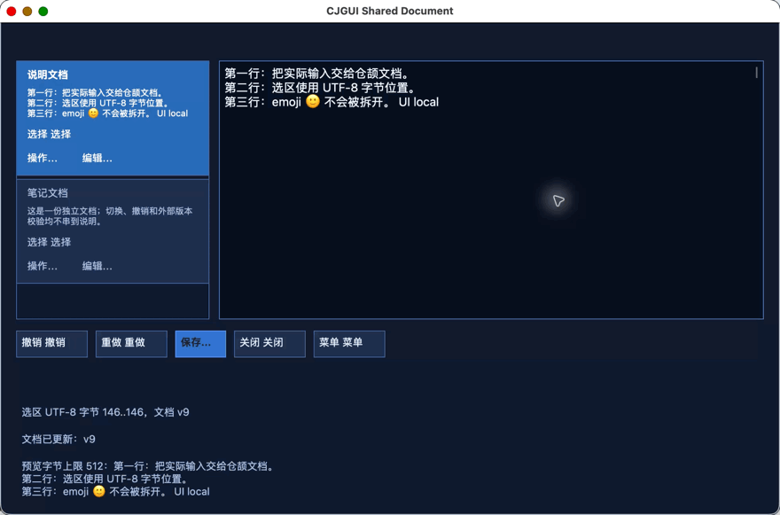

# CJGUI — 面向人和 Agent 的仓颉自绘 GUI

**业务定义一次，手写界面、生成界面与 Agent 工具一起使用。**

CJGUI 用仓颉实现组件、布局、状态和交互，通过原生后端运行在 **macOS、Windows 与鸿蒙**。它把应用的数据、当前上下文和业务动作开放为可发现、可校验的接口，让人能在窗口里操作，让 Agent 能直接读取和修改同一份内容，也能在运行中组合新的界面。

适合编辑器、配置工具、数据工作台，以及需要让人和 AI 接续处理任务的应用。你决定业务、交互方式与模型，CJGUI 负责把界面、输入和公开操作接起来。

[运行示例](#运行一个窗口) · [看实际演示](#人开始工具接续人继续) · [三平台进展](#三个原生后端共享仓颉核心) · [开发文档](runtime/cjgui/README.md)

<sub>开发预览 · macOS / Apple Silicon 优先 · Windows 与鸿蒙已有正常应用验证 · Apache 2.0</sub>

| CJGUI 的重点 | 带给应用开发者什么 |
| --- | --- |
| **仓颉自绘与性能设计** | 自建组件、布局与场景，接入系统图形和文字服务；按视口准备内容，复用排版与绘制资源。 |
| **业务规则只定义一次** | 字段、校验、权限与动作共用声明，手写表单、生成控件和工具查询一起使用。 |
| **人和 Agent 共享应用数据** | 工具能发现对象、读取版本并调用实际业务操作；结果回到用户正在使用的窗口。 |
| **运行中生成和修改界面** | 根据任务组合表单与面板，复用已有数据绑定；手写区与生成区可以同时工作。 |

## 人开始，工具接续，人继续

在窗口里写一段文字，通过公开接口追加内容，再回到窗口继续写。三步修改同一份文档，外部操作的结果直接出现在编辑区。



<sub>26 秒真实窗口实录。外部操作使用公开脚本客户端；真实模型的任务执行效果另行评测。[观看 MP4](docs/assets/demo/cjgui-shared-document-real-demo.mp4) · [素材说明](docs/assets/demo/README.md)</sub>

[完整演示（约 2 分 15 秒）](docs/contest/2026-10-07/demo/README.md)还展示了手写与生成面板联动：人提交任务后，两边标题一起变为只读；工具追加备注，两边一起更新；工具尝试修改冻结标题，应用拒绝并保留原内容。

## 一套业务定义，三个操作入口

应用声明字段的类型、必填条件、长度限制、可执行动作和真实数据绑定。**手写控件、运行时生成控件、外部工具读取同一份声明，修改交给同一个业务入口。** 改一条字段规则，三个入口都按这条规则工作。

公开客户端可以发现应用当前提供的资源、动作及参数，读取内容、草稿、选择和版本，再提交操作。授权范围内可以处理屏幕外的数据；遇到版本冲突或业务拒绝，调用者得到明确结果。应用开发者仍掌握数据与权限。

这使“选中一段 → 交给 Agent 修改 → 人继续编辑”有了可复用的接口基础。模型供应商、Agent 框架、聊天框和任务编排由应用选择。

[字段绑定与生成接口](runtime/cjgui/README.md#运行时生成式接入experimental已接通公开闭环) · [公开客户端与授权调用](runtime/cjgui/shared_operation_core/README.md)

## 让界面随任务变化

应用可以保留固定主界面，同时开放一个生成区。外部工具查询组件与字段目录，提交面板结构，框架将它变成可操作的自绘控件；控件直接使用应用已有的字段与动作。

- **生成可用的控件**：输入框修改真实草稿，按钮调用真实业务动作，人的操作能继续推进任务。
- **调整结构，接续编辑**：稳定 key 相同的控件可保留草稿；手写区与生成区共用数据。
- **失败保留原界面**：未知组件、非法属性、结构版本冲突或超出预算的提交会被拒绝。

当前已在 macOS 生成式任务面板及鸿蒙设置、温控样例中验证。[生成式面板源码](runtime/cjgui/examples/generated_panel_consumer/) · [接口与结构示例](runtime/cjgui/README.md#运行时生成式接入experimental已接通公开闭环)

## 自绘、按需准备、资源复用

**性能设计落实在“每次交互需要做多少工作”上。** CJGUI 在仓颉侧组织组件树、布局和场景，平台后端使用系统 GPU、字体、窗口与输入服务。组件与渲染调度由框架维护，系统文字排版和输入法继续使用平台能力。

| 机制 | 当前实现与用途 |
| --- | --- |
| 视口虚拟化 | 列表与树只创建视口附近的条目；大文档用有界文本窗口显示内容，源选区仍可覆盖全文。 |
| 排版与资源复用 | 内容、样式和约束有效时复用排版；图片按身份与版本缓存，减少重复解码和准备。 |
| 有界场景准备 | 将候选场景分步准备，到预算即让出；准备完成后再提交，取消后回收资源。Windows 已由两个正常应用验证这条路径。 |
| 输入与画面协调 | 将文本位置、选区和绘制绑定到相应正文与排版版本，协调人输入、外部修改与模式切换。 |

主渲染路径未引入 Qt、Flutter、GPUI、Slint 或 SDL 等 GUI 框架依赖；这些项目用于参考实现思路。系统 API 和平台 SDK 是实际依赖。自绘与有界准备是优化基础，持续交互延迟和资源成本仍以实际测量为准。

[组件、布局与渲染 API](runtime/cjgui/README.md) · [虚拟树与多选](runtime/cjgui/README.md#树形数据与多选experimental) · [文字资源复用](docs/plans/2026-09-23-incremental-text-style-binding-milestone.md)

## 三个原生后端，共享仓颉核心

组件、业务状态和共同操作协议复用仓颉核心，平台后端处理窗口、绘制、文字与系统输入。Pharos Mark 是检验这条路线的编辑器应用；规则编辑器、温控与普通文本窗口用于验证框架能被不同应用复用。

| 平台 | 系统能力 | 已有应用验证 |
| --- | --- | --- |
| **macOS** | AppKit · Metal · CoreText / TextKit | 多窗口、文本编辑、运行时生成界面、共同操作、虚拟列表与树、图片、主题及效果。 |
| **Windows** | Win32 · Direct3D 11 / DXGI · DirectWrite | Pharos Mark 与独立文本窗口；有界场景准备、源码/预览往返、Undo/Redo、公开工具修改、人继续输入、保存重开。 |
| **鸿蒙** | ArkTS 薄宿主 · XComponent · Native Drawing / Typography | Pharos Mark、设置与温控 HAP；触摸与系统输入、生成面板、共享图片、公开操作与保存重开。 |

### 最近推进的能力

截至 **2026-10-12**，在既有组件与生成式接口之外，三平台正在把共享机制带入更完整的编辑和文件操作：

- **Windows 已走通 252KB、1MiB、8MiB 三档写作链**：选择、源码/预览切换、替换、撤销重做、公开工具修改与人续写、保存、正常关闭、新进程重开及全文核验。第二个普通文本应用也已使用共同框架机制。
- **macOS 已有 1GiB 文档的实际操作与文件验证**：人输入、公开 Agent 协议修改、人继续输入，以及保存、正常关闭、新进程重开和固定版本全文比对。
- **鸿蒙模拟器已完成 64MiB 与 1GiB 文档的部分正常操作链**：包含输入、保存、新进程重开与全文核验；温控应用同步验证共同输入、滚动及字段隔离。

这些结果证明了具体路径的可用范围。**GiB 文件验证通过，不代表 GiB 连续编辑已经流畅。** 长距离拖选、跨窗口输入衔接、预览选择反馈和内存成本仍在优化，下面列出各平台边界。

[macOS 应用与打包](runtime/cjgui/MACOS_APPLICATION_HOST.md) · [Windows 阶段与构建说明](docs/plans/2026-10-09-windows-bounded-preparation.md) · [鸿蒙构建与部署](runtime/cjgui/platforms/ohos/README.md) · [最新开发状态](runtime/cjgui/ACTIVE_DIRECTION.md)

<details>
<summary>开发预览：平台条件与仍在完善的部分</summary>

- 公共 API 仍为 experimental，三平台的覆盖范围不完全相同。Linux、Android 后端尚未交付。
- **macOS** 以 Apple Silicon 为主要验证环境。大文件长拖选、输入交接、交互时延与滚动图形资源成本仍在优化；完整 VoiceOver 与物理跨屏表现未完成验证。Metal 主绘制路径仍提交完整帧。
- **Windows** 的上述结果来自 Windows 11 ARM64 虚拟机中的 x64 应用。当前应用容量为 16MiB，已验写作链最大为原始 8MiB；预览拖选反馈延迟仍有用户复现。构建目前使用 Windows 捕获 → Mac LLVM 编译 → Windows 链接，普通仓颉构建崩溃问题仍保留。物理显卡、跨屏与完整 UI Automation 尚未验证。
- **鸿蒙** 的上述结果限于当前 SDK 与模拟器。大文档跨窗替换、拒绝后的输入恢复、100ms 反馈与资源预算尚未全部通过；真机性能、输入法完整边界和发布审核另行验证。
- 公开脚本客户端验证的是应用接口；真实模型的任务规划、工具选择和完成效果需单独评测。当前不承诺普遍 16ms 帧预算或各平台性能相当。

</details>

## 运行一个窗口

准备 macOS / Apple Silicon、仓颉 1.1.3 和 Xcode Command Line Tools。将 SDK 路径替换为你的安装目录：

```sh
export CANGJIE_HOME=/absolute/path/to/cangjie-1.1.3
source "$CANGJIE_HOME/envsetup.sh"

git clone https://gitcode.com/aiulms/cjgui.git
cd cjgui
zsh runtime/cjgui/examples/rule_set_window_app/run.sh
```

最后一条命令启动规则编辑器；追加 `--build-only` 可只构建。要试用上面的文档窗口，运行 `zsh runtime/cjgui/examples/shared_document_window_app/run.sh`。

runner 负责平台桥接构建和应用 bundle。[环境与打包说明](runtime/cjgui/MACOS_APPLICATION_HOST.md) · [工具链问题](docs/setup/CANGJIE_ISSUE_LEDGER.md)

## 创建自己的应用

沿用上面的工具链环境，在仓库根目录执行：

```sh
zsh runtime/cjgui/scripts/create_macos_application.sh ui-only /tmp/MyCJGUIApp
zsh /tmp/MyCJGUIApp/run.sh
```

`ui-only` 创建普通 UI 应用。需要共同操作入口时，换成 `collaboration` 并使用另一个新目录。界面和业务动作由仓颉 controller 定义，框架 runner 管理构建与打包。

[模板与资源指南](runtime/cjgui/MACOS_APPLICATION_HOST.md) · [公开客户端：授权、读取与调用](runtime/cjgui/shared_operation_core/README.md)

## 文档与贡献

- [开发文档](runtime/cjgui/README.md)：组件、布局、输入、生成界面与渲染。
- [共同操作设计](docs/core/AI_NATIVE_UI_SEMANTICS.md)：字段、上下文、动作和授权。
- [开发动态](runtime/cjgui/ACTIVE_DIRECTION.md) · [设计导航](docs/plans/DESIGN_INTENT_INDEX.md) · [完整文档目录](docs/README.md)。
- [初赛材料](docs/contest/2026-10-07/README.md)：项目提案、验证、查重与演示。
- [协作规则](AGENTS.md) · [问题反馈](docs/setup/CANGJIE_ISSUE_LEDGER.md)。

## 许可证

[Apache License 2.0](LICENSE) · Copyright 2026 CJGUI contributors · [NOTICE](NOTICE)

原创代码、文档和原创资源采用 Apache 2.0；第三方软件与平台 SDK 保持各自许可证。
