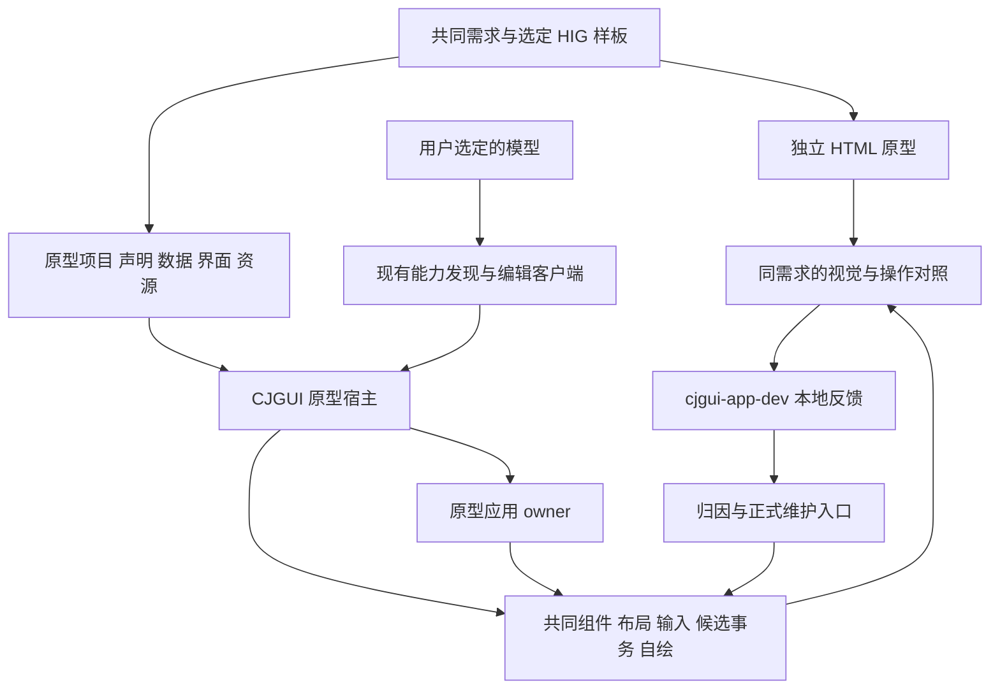

# CJGUI 通用原型宿主与 HTML 对照验证方案

日期：2026-11-08。当前已实施并补采受影响对照；最新候选结果见 §10，原方案与旧轮文档检查作为历史保留。用户选择 **Apple macOS HIG 作为视觉与交互基准，借鉴 ArkUI 的组件组合和布局思路**。当前唯一执行范围以[完整任务](../ai/2026-11-08-prototype-host-blocker-decisions.md)为准，不由早期方案扩大修复权。

建议建设一个使用 CJGUI 公共接口的 macOS 原型宿主：编译后反复打开不同原型项目，模型通过现有公开入口生成和修改界面，人通过正常窗口输入和操作。相同设计需求另用 HTML/CSS/JavaScript 实现，作为独立对照；发现的问题通过现有 `cjgui-app-dev` 技能保留证据、修订归因，并接回框架负责模块。

这一阶段增加的是可复用的运行时消费与设计验证能力。主要新增成本在通用原型数据与动作承载、项目载入和适配接线；窗口、自绘、输入、候选事务、集合及反馈系统有现成资产可复用。它是一项中等规模的集成与公共能力补接任务，不能仅按“加一个打开文件按钮”估算。

## 1 交付目标与范围

完成后，用户应能打开一个宿主，向模型描述界面，得到可操作的 CJGUI 原型，再持续调整布局、样式、字段和有限交互。换一个受支持领域的原型，应更换项目声明、数据和资源，无需为每个原型修改仓颉源码、重新编译或另造宿主。

首轮交付范围：

- macOS 普通应用宿主；明确版本的可运行本地 `.app`、源码和构建入口。
- 一个通用的原型项目载入入口，复用已有 `cjgui.ui-document`、能力目录与候选提交；支持项目切换、连续修改和保存重开。
- 有界的本地原型数据、字段、校验、动作和集合绑定；使用真实输入及原 owner 写入路径。
- 一套依据选定 macOS HIG 样板形成的默认主题、组件状态和常见布局配方，手写与生成共用。
- 三个不同类型的原型及各自独立的 HTML 对照；至少一条真实模型公开消费链。
- 使用既有技能反馈格式的观察、归因与修复回接；修复影响本轮交付的已确认共同问题。

首轮不包含通用脚本引擎、任意源码热重载、拖拽设计器、完整 HTML/CSS 兼容层、复杂业务后端、富文本编辑器或多平台追平。高级材质、复杂图表和任意绘图按具体需求保留缺口，不要求先补齐全部控件库。现有基础矢量能力继续保留，不能因生成目录未开放就声称框架完全不能绘图。

原型的界面、资源、配方和部分绑定可继续用于正式应用；正式业务仍须接真实领域 owner、持久化和权限，不能把本地示例动作写成真实业务已经完成。

## 2 已有能力与待补能力评估

以下基于编制当日工作区的公开文档及相关源码。工作区存在其他任务的未提交修改；这些结论描述复用入口，不声明新宿主或某一导出 SDK 已经验证。实施前应对实际选定版本重新识别依赖和构建输入。

| 能力 | 当前可复用依据 | 本阶段补齐内容 | 投入判断 |
| --- | --- | --- | --- |
| 普通窗口与构建分发 | `CjguiMacosApplicationHost`、公共 runner、创建器和本地 bundle 机制 | 建一个可复用宿主，发布实际可运行的本地候选；测试从非源码目录启动 | 较小 |
| 运行时生成与编辑 | catalog、region、typed client、结构编辑计划、候选接受与失败保旧 | 宿主发布完整的本次支持目录和稳定外部入口；从空区生成任意受支持结构 | 以集成为主 |
| 界面保存载入 | `CjguiUiDocumentWorkspace`、session、预览/确认及 close guard | 与原型项目、示例数据和资源引用组合；区分保存界面与保存原型会话 | 中等 |
| 通用字段与动作 | shared form、`CjguiGeneratedUiFormBinding`、多对象绑定已存在；mixed 模板仍声明具体打印业务 | 从原型声明创建应用 owner，支持不同字段/对象；处理新增字段与项目换属的生命周期 | 最大新增项，正确性风险较高 |
| HIG 默认外观 | 现有 theme、named styles、`boundStyle()`、交互态和反馈组件 | 增加或校准可选 HIG 桌面主题与配方，共用原角色接口；保留现有主题 | 中等 |
| 基础布局 | 横纵容器、Stack、Wrap、AspectRatio、Spacer、Split、Scroll 等已有入口 | 配方与生成属性补接，验证正常缩放；缺少的通用行为修共同布局归属 | 中等，以接通优先 |
| 窗口适配规则 | 公共布局文档明确尚未包含断点 DSL；窄窗需应用选择适配组合 | 提供有界宽度条件与布局变体选择，复用布局引擎和稳定身份 | 中等，先做窄范围 |
| 列表与表格 | `CjguiGeneratedUiCollection` 已把真实集合接入生成式复合组件；有集合 workspace、选择及虚拟列表 | 通用原型数据源接入；发布可发现的集合引用与行为 | 以适配为主 |
| 卡片与图形 | 虚拟卡片网格和基础矢量绘制已经存在 | 核实际生成式可达性，优先注册或补公开适配；不重造网格/绘制后端 | 依实际缺口确定 |
| 图片、字体、命名样式 | catalog 已有资源及样式注册机制 | 项目相对路径、资源身份、缺失反馈、搬移后重开；同目录资源由一个声明管理 | 中等 |
| 诊断与状态读回 | accepted 几何/裁剪/交互态诊断、字段与动作投影已有入口 | 在原型宿主中启用可选诊断；输出与比较报告关联 | 较小 |
| 反馈采集与筛选 | 技能已有 create/list/show/append、证据保全和 triage | 增加原型工作流的短指南/检索入口（确有需要时）；复用现有记录结构 | 较小 |

关键源码边界：

- [表单绑定](../../runtime/cjgui/src/composable_ui_generated_form_binding.cj)的构造器从 `domain.formBinding()` 取得字段，并由 `capabilityCatalog()` 发布；[mixed 领域](../../runtime/cjgui/templates/macos_application/mixed_form/src/domain.cj)包含固定业务字段。现有“运行时改布局”不自动等于“运行时定义任意新业务”。
- [生成式集合](../../runtime/cjgui/src/composable_ui_generated_collection.cj)已有编译好的集合适配器及接受事务中的视图状态参与机制。应复用真实 list/table 数据源、选择和视口，不能把记录数量等同于要一次挂载的普通节点数。
- [能力目录](../../runtime/cjgui/src/composable_ui_generated.cj)的节点上限与[运行时组合](../../runtime/cjgui/src/composable_ui_runtime_composition.cj)的预算是不同层级。现有组合批次上限包含 8 个定义、96 个元素声明、256 个模板节点和 262144 字节；这些数字不是“一屏最多 96 个控件”，也不能证明一屏必然够用。宿主必须发现和发布实际限制，规模不足时保留原需求及拒绝结果。

投入的关键路径为：**选定视觉样板 → 最小项目载入与真实字段闭环 → 通用数据/集合/资源接入 → 其他领域复用 → 对照与修复后正常消费**。加载和换属的正确性比宿主外壳工作量更不确定。本次只读评估不承诺日历工期；实施时用第一条真实链取得构建、启动和修改耗时，在同一阶段报告里校准剩余工作，不另开估时台账。

## 3 视觉标准与 ArkUI 借鉴边界

### 3.1 采用可见样板和明确规则

主标准为 [Apple HIG](https://developer.apple.com/design/human-interface-guidelines/) 的 macOS 使用情境，配合 [Apple Design Resources](https://developer.apple.com/design/resources/) 中的 macOS UI Kit。HIG 指导布局与交互；设计资源提供可见组件样板；SwiftUI、AppKit 是实现框架，不作为 CJGUI 的依赖。

在实施阶段为首批三个案例固定参考来源、访问日期/版本、窗口内容区尺寸与对应状态。先选择适合桌面工具的表单、侧栏/列表/详情、内容卡片样板；不以笼统的“苹果风”代替参考。官方资料无法访问时记录该项未核实，不能凭印象编造官方尺寸。

需要落到共同主题与配方的内容：

| 方面 | 本阶段应形成的规则 | 如何验证 |
| --- | --- | --- |
| 信息层级 | 标题、正文、辅助说明、分组标签、状态反馈有稳定角色 | 同一内容在 HTML/CJGUI 中层级清楚，长中文和中英混排仍可读 |
| 桌面密度 | 控件高度、行距、组内与组间间距、内边距由少量公共值决定 | 默认组件组合即可协调，避免逐页用大量例外值修画面 |
| 操作层次 | 主/次/低强调操作，以及导航选中态各有用途 | 主操作可辨认；选中、焦点、悬停、禁用能够分别表达 |
| 布局与缩放 | 侧栏、工具栏、内容区、检查器和滚动区域各有尺寸责任 | 窄窗不遮挡主要动作，内容溢出有明确滚动/省略/折叠策略 |
| 颜色与主题 | 背景、分组表面、文字、边框、强调、错误等采用语义角色 | 亮暗外观切换后状态与文字保持可辨认 |
| 状态完整性 | 正常、空、加载示意、错误、禁用、选择与焦点均有样板 | 不只验默认静态画面；加载示意不冒充真实异步后端 |

准确尺寸从选定参考与实际渲染校准；CJGUI 自行选择的适配值必须标成项目决定，不能标成 Apple 官方 token。复用 [STYLE_ROLES](../../runtime/cjgui/STYLE_ROLES.md) 的角色与交互态机制，新增主题采用明确选择，不悄悄改掉已有应用的默认外观。

HIG 的布局、层级和交互要求先落实。高级玻璃、模糊和复杂材质只有在所选样板确需时才进入本阶段关键路径；未做的效果明确标为差异，不声称完整复刻 macOS。框架通过可替换主题支持其他视觉风格。

### 3.2 借鉴 ArkUI 的组件和布局组织

参考 [ArkUI 开发概述](https://developer.huawei.com/consumer/en/doc/harmonyos-guides/arkts-ui-development-overview/) 与[布局概述](https://developer.huawei.com/consumer/en/doc/harmonyos-guides/arkts-layout-development-overview/)，重点研究组件组合、布局职责、状态保留和适配规则。HDS 与 UI Design Kit 是另一套设计/组件体系；本阶段不把它的视觉值随意混入 HIG 默认主题。

- 横纵、叠放、弹性、列表和网格先映射到 CJGUI 现有组件；名称不同不构成重做理由。
- 可复用组合应由共同字段/动作、公共样式和已有布局构成，模型可以调整内容与结构；编译好的组件工厂和运行时组合定义如实区分。
- 首版适配只需要少量有界宽度条件和布局变体，切换仍使用同一组稳定 key 与原 owner。先核已有能力，再决定新增最小公共声明；不预设要实现完整 GridRow/GridCol 或复制装饰器体系。
- 研究的是机制与使用方式。按 [AGENTS 共同实现与平台复用](../../AGENTS.md#shared-implementation)及外部框架边界，在既有架构内实现；不链接、嵌入或通过子进程调用 ArkUI、SwiftUI、其他 GUI 框架来替代 CJGUI 的界面。

## 4 通用原型宿主的结构与责任



### 4.1 宿主作为普通消费者

建议源码放在 `runtime/cjgui/examples/prototype_host_app/`，沿普通创建/构建入口使用公共框架；这是建议新增目录，当前尚不存在。宿主可有少量手写工具栏和状态区，原型主体来自运行时结构，保留混合消费验证。

宿主负责打开/切换项目、保存界面与会话、资源定位、预览结果和可选诊断；框架继续负责窗口、布局、输入、场景接受、交互身份与释放。使用既有 descriptor 与客户端，不另定义一套编辑 RPC。只保留一个可复用构建目录和一个自有验收实例；连续编辑期间不重启恢复现场。

普通原型使用者应直接启动已构建的 `.app`，不经过编译 runner，也不需要为每个项目安装工具链。交付验证要检查 bundle 内运行依赖和资源来源，并在本任务私有的含空格/中文路径、非源码 cwd 下直接启动，确认没有调用编译器或借用源码树资源；不为此移动或破坏用户现有工具链。框架升级或新增底层能力仍可能要求重建宿主，本机独立启动不等于已验证全新设备安装、公证或正式发布。

### 4.2 最小原型项目

建议采用一个可搬移目录；以下名称是待实现的文件组织建议，不是现有协议：

```text
example-project/
  prototype.json       项目版本、共同字段/动作、数据源和资源声明
  ui/                  已有 cjgui.ui-document 格式的页面或区域文件
  assets/              实际使用的图片等本地资源
  session.json         可选的原型业务会话，由宿主显式保存
```

`prototype.json` 是原型应用的业务定义及项目清单，不替换 `cjgui.ui-document`，也不新增另一套界面解释器。字段类型、约束和动作含义只定义一次，供原型 owner、手写投影、能力发现和生成绑定共用。初始样例数据与可变会话分开；保存界面不暗中 Apply，Apply 不自动声称已写入文件。

首版支持 TEXT、INTEGER、BOOLEAN 及既有选择呈现，平面记录集合和稳定记录 ID。动作范围覆盖字段写入、Apply/Cancel、选择/筛选、页面或视图切换、弹层开关及恢复样例等本地交互；具体动作名在实现时沿现有契约定义，不把此列表当作已有 API。动作可以有参数与声明式约束，但不执行文件中任意仓颉、JavaScript、Python 或 shell 代码。

将原型从 A 项目换成 B 项目必须更换明确的原型 owner、目录和文件关联。新项目校验或场景接受失败时保留旧项目；先注册一半、清空旧草稿再报错不符合要求。项目有未保存内容时使用正常应用的保存/放弃/取消流程。

同项目兼容修改应能新增普通字段、修改其规则或重排界面，不编译、不重启。相同稳定身份与类型的字段保留有效草稿及输入上下文；换类型、删除字段、替换 owner 时沿既有身份/版本/在途输入结算规则处理，不隐式迁移不兼容值。首版不承诺任意跨版本业务数据库迁移；不兼容请求可具名拒绝，但不能把正常新增字段也退回改源码。

### 4.3 样式、资源与集合只接一次

HIG 主题角色通过现有 named-style catalog 发布，同一角色供手写与生成使用。图片和字体通过已有资源声明注册，界面只引用逻辑身份与版本；宿主明确以项目根解析资源，搬移项目或从不同 cwd 启动仍得到同一资源。首版只接实际支持并验证的格式，不用空白占位伪装图片加载成功。

列表/表格复用 `CjguiGeneratedUiCollection` 及公共集合机制；卡片复用现有网格/布局。筛选、选中记录和详情编辑归原型 owner 或既有选择模块，视口与几何留在视图模块。仅当缺少生成式公共接入时补接，不在宿主写第二套虚拟列表、选择或滚动状态机。

打开另一领域的项目不能靠 `if projectName == ...` 选择编译好的整页。可注册可复用组件/组合，但页面布局、内容、字段和绑定应来自项目或模型提交。第三个项目必须能够复用同一宿主二进制。

## 5 HTML 对照验证

### 5.1 对照条件

HTML/CSS/JavaScript 运行于独立浏览器，不嵌入 CJGUI。双方共享需求、选定参考、确定性初始数据和操作期望；分别实现布局与交互。HTML 结果也要检查，不能自动充当正确答案。

先写一份简短案例说明，包含内容、交互、主要状态及窗口适配期望。双方均可读取自己的公开文档和配方；记录实际模型、资料、输入提示与人工/模型修正。执行模型本身可完成两种实现与真实公开调用，无需为对照另调外部模型。若上下文已见框架内部源码，应如实标为开发者知情条件下的使用，不宣称独立新用户盲测。

公共初始数据只保留一份，两个实现分别维护运行状态；期望结果从案例输入和规则独立核算，不读取 CJGUI 的输出再当作期望。模型生成的 HTML 不自动翻译成 CJGUI DSL；HTML 源码可用于定位具体差异，但最终实现消费 CJGUI 的真实能力。

### 5.2 三个首轮案例

| 案例 | 需求与数据 | 必须实际完成的操作 | 验证价值 |
| --- | --- | --- | --- |
| A 桌面设置表单 | 分组、文本/整数/布尔/选择字段、帮助与错误信息 | 输入与 Tab 导航；整数清空后纠正；Apply/Cancel；新增字段；有草稿时重排；切外观 | 共同声明、主题、输入、错误反馈和运行时修改 |
| B 资产列表与详情 | 200 条确定性记录，侧栏、筛选列表、选中项详情；长标题和中文 | 滚动与筛选；选择记录；编辑并应用；切换另一记录后返回；缩窄/恢复窗口 | 集合虚拟化、稳定身份、布局适配和多 owner 接入 |
| C 素材卡片面板 | 12 张卡片、本地图片、标签及状态；明确空结果/资源缺失状态 | 换列/换行；卡片选择；详情或弹层；筛选为空；恢复；保存并重开 | 图像、资源定位、组合能力、状态完整性和不同领域复用 |

200 条是案例业务负载，不要求同时创建 200 份完整详情树。不能为绕过缺陷或预算把它减少后仍说原案例通过。案例不使用真实用户文档，不把本轮扩大成 GiB 编辑器验收。

每例检查内容区宽度 1280、960、720 点下的布局，统一记录实际高度、显示缩放和浏览器 DPR/缩放；这些是本方案的测试条件，不是 HIG 官方断点。主宽度检查亮暗外观，其他宽度验证所需的滚动、折叠和换行。固定工具栏/窗口装饰与可编辑原型内容区分开比较，不能用裁切掩盖内容被挡。

### 5.3 观察内容与取证

正常输入与动作优先使用原生语义入口和 `agent-desktop`，浏览器沿其合适工具。视觉判断需要的同状态截图/局部截图属于本任务必要证据，结合 accepted 布局诊断定位；不把像素逐点完全相同设为通过条件，也不只靠 AX 树宣称外观一致。

每例完成一次有意义的连续会话：初次生成 → 正常输入 → 改布局/主题 → 改字段或集合 → 失败候选 → 合法续改 → 保存重开。失败候选至少覆盖未知属性和过期版本，核对具名拒绝及旧界面/原型状态保持；与实际新增机制相关的删除、换属和迟到事件另做最小反例。没有新问题不为了增加轮数重复全套。

对每个差异记录目标、实际效果及以下原因之一，原因可以随证据修订：

- 正确示例/文档后可完成：模型使用或可发现性问题。
- 手写同版组件可完成、生成入口不能：公开能力/接线缺口。
- 能完成但大量重复代码/魔数/私有适配：API 与配方易用性问题。
- 正确声明仍出现错误几何、输入、显示或释放：框架行为问题。
- 缺少合理需求所需原语：能力请求，不能冒称已有 API 的 bug。
- 来源混用、环境或工具失败：环境问题，保留影响范围。

只有归因仍不清的差异才追加最小手写对照，不为所有案例再造第三套完整应用。

时间与成本分开记录：首次环境准备/冷构建、已安装宿主打开项目、模型生成时间、提交到接受、提交到可见、修正耗时、重编译/重启次数，以及普通编辑/空闲/切换后的资源变化。只取得 accepted 回执时不能称为已经显示；有限样本给原数和范围，不伪装成稳定性或长期内存证明。本阶段不预设 CJGUI 必须快于 HTML，也不把旧 16/32ms 未过门改成通过。

模型自己通过公开客户端生成并修改运行中的结构，可以记为真实模型消费；预录 Python 候选回放只能记为脚本消费。原生自动化输入、系统 IME、人亲自试用分别标明。技术与可见结果具备证据后交付候选，未取得的用户主观偏好确认保持未取得，不伪造用户审美认可。

## 6 使用 cjgui-app-dev 完成反馈回接

复用技能入口 [SKILL.md](../../runtime/cjgui/skills/cjgui-app-dev/SKILL.md) 和[反馈指南](../../runtime/cjgui/skills/cjgui-app-dev/references/feedback.md)。创建/修改宿主属于消费方应用工作，先按该技能识别实际依赖、查询同版 API；遇到已确认的共同框架问题，按本阶段框架实施范围回到维护源码修复，SDK 副本保持只读。

### 6.1 记录与归因

使用现有 `feedback.py` 的字段，不新建第二套 issue 数据库，也不向观察 JSON 塞入脚本不认识的键。案例编号、HTML 参照、对比图、候选文档、读回、构建身份与原始失败通过 `evidence` / `links` 关联。

最低有效观察包含：目标及参考依据、预期/实际、实际 SDK/构建/运行身份、最小复现、已尝试方法与失败、当前分类与未决假设、易用性建议。`expected` 要区分公开契约、HIG 参考与本方案产品需求，不能把审美偏好一律记为框架违约。

同一原因先 list/show 后 append，版本变化和后续结论追加事件；已记录的误用不删原件。普通一次性拼写错误不必入库。先记事实再筛选，不能为了展示反馈功能制造缺陷。

### 6.2 操作示例

以下为实施时的命令说明，本方案编制不执行写入。`APP` 是实际宿主工程根；`SKILL` 是当前真实加载的技能目录；解释器须为 Python 3.11+。默认反馈目录为宿主的 `.cjgui/feedback/`。

```sh
python3 "$SKILL/scripts/identify.py" --app "$APP"
python3 "$SKILL/scripts/lookup.py" --app "$APP" --query "布局与主题"
python3 "$SKILL/scripts/feedback.py" template > observation.json
# 填入完整的真实观察和必要本地证据路径后：
python3 "$SKILL/scripts/feedback.py" create --app "$APP" --input observation.json
python3 "$SKILL/scripts/feedback.py" list --root "$APP/.cjgui/feedback"
python3 "$SKILL/scripts/feedback.py" show --root "$APP/.cjgui/feedback" --issue ISSUE_ID
python3 "$SKILL/scripts/feedback.py" append --root "$APP/.cjgui/feedback" --issue ISSUE_ID --input followup.json
```

优先将反馈放入本阶段既有证据目录；使用显式 `--root` 前建立准确目录，`create` 仍需要 `--app`。必要小原件由技能复制保全，大日志用 `links` 指向受控原件，避免重复拷贝整套产物。

### 6.3 从观察到交付

`triage.decision` 继续使用 `pending`、`needs_evidence`、`framework_fix`、`usability_improvement`、`no_framework_action`；非 pending 必须写 reason。分类与是否值得改进独立：接入错误也可能暴露默认值/文档问题，能力缺失不自动等于实现 bug。

确认问题后，回到[设计意图导航的反馈入口](DESIGN_INTENT_INDEX.md#问题反馈如何接回主线)：本阶段需要的共同缺陷修在责任模块，工具链/长期 workaround 进入已有问题账本。观察仅链接正式维护位置，正式状态不由技能自动裁定。

分别填写 `source_fix`、`sdk_inclusion`、`consumer_verification`：源码修复、被哪个 SDK/清单包含、哪个真实应用与场景验证通过，三者不可合并成一个“已修复”。原型绕开了缺陷只能记 workaround；必须保留原要求、失败证据和移除条件。

已确认的用法回到同版公开文档/配方。若需要帮助模型发现原型工作流，在维护源技能增加一个简短引用入口并随 SDK 交付；不把全部案例、未经证实的限制或某平台特殊行为塞进技能主文件。

## 7 实施顺序与完成条件

### 7.1 一个完整阶段内推进

1. **核身份与选样板。** 读现行规则、当前状态和本方案；保护并行改动，选择实际源码/SDK，记录输出边界和空间。固定三例参考与需求，核已有接口，先列本阶段真实缺口。
2. **完成案例 A 的最短闭环。** 通用宿主加载声明与 UI，真实字段写入/读回、模型持续改界面、失败保旧、保存重开；同步得到独立 HTML 对照。此时就能暴露最早的接入成本，不先做完整设计工具。
3. **贯通共同主题和通用项目能力。** 把反复使用的 HIG 角色、有限适配、字段/动作/资源接线做成可复用能力，补必要公共接口与文档。新增公共行为应同时可被手写与生成消费。
4. **使用同一二进制完成 B、C。** 验证不同领域与数据量，修影响交付的共同问题；只有新底层能力或缺陷修复需要重建，随后冻结最终候选再合并做受影响回归。
5. **完成反馈、SDK 与交接。** 保存原始对照和失败链，完成已确认范围内的修复及正常消费者验证；导出必要 SDK/宿主候选并核真实消费，更新现有文档及执行状态，集中报告一次。

这是完整阶段，不要求每个文件或小补丁请示。结构/归属或重大风险未明时遵守 AGENTS 的复盘和升级规则；只暂停依赖具体问题的工作，独立工作继续。用户选定的执行模型主责整包；本方案不授权外部咨询、额外代理或恢复已停止的执行线。

### 7.2 完成条件

- 三个案例可以由同一个宿主候选打开；不同领域的内容与字段由项目声明决定，没有按案例名硬编码整页。预构建 `.app` 在约定的独立路径直接启动，不依赖每次编译或源码目录资源。
- 至少一次从空生成区完成真实模型发现能力、生成、正常窗口输入、模型读回和后续修改；注明模型使用了什么上下文。
- 在支持范围内，布局/主题修改、普通字段新增和案例切换不要求重新编译或重启；兼容修改保留有效草稿、焦点/选区与视口，失效绑定不接收旧写入。
- 保存/重开恢复的是约定的界面、资源关联与原型数据/草稿；不同 cwd/项目搬移、坏文件、文件冲突及取消路径有明确行为，失败不损坏旧项目。
- 三例的正常交互、约定窗口宽度及状态均有结果；视觉结论指向具体参考和画面，不以协议成功替代实际呈现。
- 有实际 HTML 对照、时间/资源原数和差异归因；没有结果的能力如实标注，不用截图覆盖可交互控件或让脚本写死预期输出。
- 已确认、影响这三个案例的共同缺陷修回框架并验证；未解决项明确影响哪一条件，不把“反馈已登记”写成对应能力完成。
- 相关测试、根 `cjpm build --skip-script`、`git diff --check`、公共声明及禁止行为扫描按改动范围完成。既有失败必须在实际版本核实并说明，不能删断言或用历史报告代替本次构建。
- 至少选一个受影响的现有普通消费者验证公共改动，优先复用已有实例/案例，不另造大型应用；新增公共能力由正常 SDK 消费入口验证，纯内部探针不足。
- 构建与运行身份、输出路径、清理结果、技能观察及源码/SDK/消费三个状态对应；没有证据的范围保持未验。

## 8 写集 产物与空间

预计写集为新增宿主/案例、必要的现有公共组件与生成式适配、共同主题/布局、相关测试及同版文档。技能仅在确有发现性缺口时补短入口。`runtime_state.cj`、`cjpm.toml` 或 native 只有具体缺口确实要求时才最小修改并验证；不预先认定所有差异都要改渲染器。

建议复用一个阶段工作目录 `work/prototype-host-20261108/`，其中保存案例需求、HTML 对照、基线资源引用、必要原件、结果与当前交付引用。目录为实施建议，本轮不创建构建树。宿主源与三例项目保存在可维护源码位置，运行证据不要成为第二份权威实现。

按 [AGENTS 产物容量与收尾](../../AGENTS.md#artifact-space-budget)执行：新增保留默认不超过 10GiB，预计峰值后宿主至少剩余 20GiB；编制时宿主约剩余 218GiB，仅为当时读数，实施及高写盘前重新检查。先记录源/target/SDK/证据边界，正常诊断单文件 64MiB、当轮合计 512MiB，必要完整序列提前预留；不删慢样本或失败窗口。

每个消费者复用构建目录，完整产物保留当前候选与最近可用交付；新增验收驱动在成功/失败/取消的 finally 中释放自有进程和无用临时副本，保留可复判原件。只按准确身份清理本任务资源，不删除原工作区、用户实例、SDK 或其他任务产物；同一 cjpm target 构建/测试串行，桌面不被多个执行者争用。

集中报告给出解决的实际问题、复用和新增能力、候选路径与身份、三例对照结果、反馈及未验范围，以及新增/保留/实际释放量和宿主剩余空间。未要求不 stage、commit、push 或切分支。实施真正启动后才按规则维护 ACTIVE 的当前摘要；本方案的存在不启动任务。

## 9 依据与复用入口

- 治理与目标：[AGENTS](../../AGENTS.md)、[当前方向](../../runtime/cjgui/ACTIVE_DIRECTION.md)、[项目方向](../core/GUI_PROJECT_DIRECTION.md)、[架构契约](../core/AI_NATIVE_UI_SEMANTICS.md)、[框架验收标准](../core/CJGUI_UI_FRAMEWORK_COMPLETENESS_CRITERIA.md)、[设计意图导航](DESIGN_INTENT_INDEX.md)。
- 公共消费：[runtime README](../../runtime/cjgui/README.md)、[macOS 宿主](../../runtime/cjgui/MACOS_APPLICATION_HOST.md)、[mixed 模板](../../runtime/cjgui/templates/macos_application/mixed_form/README.md)、[运行时编辑](../../runtime/cjgui/shared_operation_core/GENERATED_EDITING.md)。
- 布局与外观：[布局原语与配方](../../runtime/cjgui/LAYOUT_PRIMITIVES.md)、[主题角色](../../runtime/cjgui/STYLE_ROLES.md)、[已有布局主题交付及未验边界](2026-11-06-layout-theme-usability.md)。该交付已经借鉴部分 ArkUI/HDS 思路，本阶段继续使用共同机制，新增 HIG 主题与具体样板。
- 反馈：[应用开发技能](../../runtime/cjgui/skills/cjgui-app-dev/SKILL.md)、[反馈操作与筛选](../../runtime/cjgui/skills/cjgui-app-dev/references/feedback.md)。
- 视觉参考：[Apple HIG](https://developer.apple.com/design/human-interface-guidelines/)、[macOS](https://developer.apple.com/design/human-interface-guidelines/designing-for-macos)、[布局](https://developer.apple.com/design/human-interface-guidelines/layout)、[侧边栏](https://developer.apple.com/design/human-interface-guidelines/sidebars)、[官方设计资源](https://developer.apple.com/design/resources/)。
- 机制参考：[ArkUI 组件与声明式开发](https://developer.huawei.com/consumer/en/doc/harmonyos-guides/arkts-ui-development-overview/)、[布局分类](https://developer.huawei.com/consumer/en/doc/harmonyos-guides/arkts-layout-development-overview/)、[UI Design Kit 与 HDS 的关系](https://developer.huawei.com/consumer/cn/doc/harmonyos-guides/ui-design-introduction/)。外部资料查询日期为 2026-11-08；不把持续更新的网址当作固定实现版本。

## 本轮文档交付检查

本轮仅新增本方案与配套实施提示词。28 处本地文件链接、其中 4 处锚点，以及空白/代码围栏检查通过；两份文档的范围与授权一致。既有 tracked diff 的 SHA-256 与开工时一致，原有修改未被改写。没有创建宿主、生成原型、运行构建、操作桌面或更改技能。实施能力与运行证据待后续用户下发任务后取得。

本轮新增并保留两份 Markdown，实际分配约 40KiB，实际释放 0；宿主剩余约 218GiB。没有构建输出或私有数据副本，无需清理旧存量。其他任务同期新增内容不属于本轮产物。


## 10 最新候选的受影响对照与使用成本

本节只补本包只读/stepper、字段重载、720详情与正常消费的受影响部分。宿主运行二进制SHA256为`2464c814feeb58aea1fde60273c123f87c114fb3f55a452cc71ee723a9b38b82`。完整结果和未过门见[交付§32](2026-11-08-prototype-host-delivery.md#32-当前候选整包接续2026-11-08)。本包没有改HTML页面、CSS/JS或公共数据要求，也没有为当前差异引入新控件/迁移机制。

### 10.1 版本、尺寸与原件

复用[旧截图清单](../../work/prototype-host-20261108/html/shots/manifest.json)的1280/960/720、空态、筛选无结果和滚动态证据；原Chrome157、DPR1与原版本范围保留，不写成当前候选全矩阵新跑。旧HTML自验原件为[39/39 DOM结果](../../work/prototype-host-20261108/evidence/html/selftest-latest.json)，不是本次框架测试。

本次用隔离的agent-browser会话重新打开原文件，只操作正常页面。新HeadlessChrome152/DPR1，HTML viewport为1280或720×788；与CJGUI外窗1280或720×820扣除32点标题栏后的内容高度对应。CJGUI原图含标题栏/阴影，DPR2；不做逐像素比较、不裁掉失败画面。浏览器版本与缩放不同不支持排版耗时的直接A/B结论。命令、源/图片哈希、尺寸与抓取方法见[补采清单](../../work/prototype-host-20261108/evidence/candidate/html/manifest.json)。初次720抓到侧栏过渡帧，原图保留并标为非最终；随后等待CSS animation停止取得settled图，没有把过渡帧直接判成HTML缺陷。

| 受影响状态 | HTML原件 | 当前CJGUI原件 | 核对范围 |
| --- | --- | --- | --- |
| 设置字段同业务草稿 | [签名草稿/整数15](../../work/prototype-host-20261108/evidence/candidate/html/settings-1280x788-draft.png) | [公开重排后](../../work/prototype-host-20261108/evidence/candidate/integration/settings-draft-reordered.png) | 同五字段、签名`团队周报候选未应用草稿`、整数15、布尔开启；通知/外观顺序与介绍文字是模型明确改动，不算缺陷 |
| 资产001、数量8、720详情 | [720 settled](../../work/prototype-host-20261108/evidence/candidate/html/assets-720x788-settled.png) | [720详情](../../work/prototype-host-20261108/evidence/candidate/integration/assets-720.png) | 同初始业务值；CJGUI标题含第5轮公共修改标记。详情字段与主要操作全部可见，列表切换/点选和恢复1280另有正常窗口原件 |
| 素材12卡、4列、选中02 | [4列/选中02](../../work/prototype-host-20261108/evidence/candidate/html/materials-1280x788-selected2.png) | [4列/详情](../../work/prototype-host-20261108/evidence/candidate/integration/materials-1280.png) | 同12卡与02标题/备注/可用状态，缺图07保留占位；HTML浮层与CJGUI固定详情区有明确设计差异 |
| 只读与默认可写 | HTML原三例无同样的readonly-demo字段组合，不伪造同页通过 | [亮色](../../work/prototype-host-20261108/evidence/candidate/integration/readonly-light.png)、[深色](../../work/prototype-host-20261108/evidence/candidate/integration/readonly-dark.png) | 额外正常消费者确认只读事实/查看/选择/禁用与可写Apply/Cancel；不得从它宣称HTML全状态等价 |

### 10.2 真实差异和归因

| 差异 | 实际结论 | 处理边界 |
| --- | --- | --- |
| B只读接线 | descriptor、手写helper、生成stepper、availability和typed事实已一致；窗口输入/owner读回支持本包修复 | 已批准框架修复，进入SDK并包外消费；与视觉主题分开判定 |
| 深色可写按钮 | readonly-demo中readonly额度±仍可见；enabled数量±和底部生成动作文字在深色不可辨，AX存在且真实动作能改值 | 新的主题/配方/渲染归属未分离，记录至HIG issue`20e491c4…`，不扩修、不称主题完整通过 |
| 通知开关/强调色/计数 | HTML是switch、色点、字符计数；CJGUI是checkbox、select，无同样字符计数 | 公开配方/设计选择及表达能力差异；不自动新增组件任务 |
| 控件密度/操作区 | HTML居中较窄面板、原生数值上下箭头、固定底栏；CJGUI较宽分组、水平±、宿主工具栏与区域动作 | 配方与应用策略。没有逐像素复刻或完整HIG认证 |
| 标签 | 最终默认/隐藏标签与AX名称按当前字段可对应，未再出现内部semanticId当可见标签 | C旧证据复用，加正常字段输入/新增字段的当前画面；AX不冒充VO |
| assets筛选/详情 | 筛选25条时旧选中项被排除，旧详情暂保留；随后点可见项才改变owner，公开第二条读回owner3001 | 应用选择策略与状态文案边界，仅记录；不能凭旧详情截图断言写错对象 |
| 窗口标题 | 换项目后窗口装饰仍显示最初“偏好设置”，正文/owner已换项目 | 应用窗口标题策略观察，只记录 |
| 卡片展示 | 两者都保留图片与07缺图；HTML铺满缩略图/徽标/浮层，CJGUI居中缩略图/文字状态/下方详情 | 应用布局及视觉配方差异；未借此改变图片/裁剪机制 |
| 新字段接入 | 声明重载后candidateMemo可发现、owner2000共享；正常原始plan提交成功并可键入 | 保存insert-plan的往返校验在本例失败（`a967f979…`），不能用成功的set_property/move泛化全部操作 |

同候选三原型及运行时声明新增/布局调整无需重编译或重启；此结论限已支持的字段新增，删字段/既有规则修改仍具名拒绝并保旧。当前普通负载中的materials持续提交和busy拒绝属于行为/性能证据，不能用静态图掩盖，见[测量报告](../../work/prototype-host-20261108/evidence/candidate/performance/MEASUREMENT.md)。

### 10.3 使用成本的实际范围

最终宿主公开链包含能力发现、原子快照、preview/saved plan、apply终态与精确读回、工具合成输入、跨项目旧请求拒绝、合法undo/redo、保存重开和新快照续改；原件集中在[candidate/integration](../../work/prototype-host-20261108/evidence/candidate/integration)。模型知晓框架/宿主源码，使用正常公开客户端；工具物理/Unicode、AX、脚本回放均有标注，没有真人或独立开发者盲测。

普通测量中9次成功公开apply内部接受p95为53.118ms，完整CLI p95为164.730ms；12次中3次materials busy拒绝保留。包外5次布局更新内部p95为31.593ms、完整CLI为100.191ms。它们是候选操作时间，不能推成整体原型开发效率。首个人已看见/可交互时间、输入到新accepted与physical present仍缺定时证据，没有承诺比HTML更快。

包外创建器、自己的owner/入口/布局实际接入：生产仓颉源码592行，测试29行，公开客户端128行；首次语法缺口修正后又触发既有nonempty-target保护，保全失败并只退役本App失败target后正常构建。成本还包括领域单测、normal GUI/API链及多次有限VO取证；不把这次开发者知情操作换算为独立用户工时。完整构建与命令见[包外RESULT](</Users/jiangxuanyang/Desktop/CJGUI Prototype Candidate Consumer/evidence/RESULT.md>)。

## 11 修复后候选的受影响对照（2026-11-09）

宿主运行二进制 SHA256 为 `f512df0863a775db33b93491fdccd7b1b8c70b3fbfba5c40221b02c1a8b00f87`；新 SDK 为 `a4ba0acb…`。HTML 页面、CSS/JS、数据与需求未改，只补受影响状态；旧 1280/960/720、空态/筛选/滚动原件与 §10 结论继续有效。

| 受影响状态 | HTML 原件 | 当前 CJGUI 原件 | 核对结论 |
| --- | --- | --- | --- |
| 只读/可写、亮/暗 | HTML 三例无同组合 readonly-demo，不能伪造同页通过 | [深色修复后](../../work/prototype-host-20261108/evidence/candidate/b-theme/readonly-dark-fixed.png)、[浅色修复后](../../work/prototype-host-20261108/evidence/candidate/b-theme/readonly-light-fixed.png) | 旧 `integration/readonly-dark.png` 的 enabled ±/底部动作不可辨已修：± 与动作常态可见，只读 quota `+` 不写、可写 quantity `+` 精确、Apply/Cancel 正常；框架命名 base+interaction 与应用动作 style 分开修 |
| 三原型 1280 | 既有三页 1280 原件（§10.1） | [settings](../../work/prototype-host-20261108/evidence/candidate/final-prototypes/settings-1280.png)、[assets](../../work/prototype-host-20261108/evidence/candidate/final-prototypes/assets-1280.png)、[materials](../../work/prototype-host-20261108/evidence/candidate/final-prototypes/materials-1280.png) | 三例同尺寸同内容区；materials 图片/缺图占位正常，修复后 4 秒静置 CPU 约 0.06s 增量、无持续提交；既有视觉差异（switch/色点/计数/底栏/浮层等）不变 |
| assets 720 详情 | 既有 720 settled 原件 | [720](../../work/prototype-host-20261108/evidence/candidate/final-prototypes/assets-720.png) | 标题/数量/启用/备注/帮助可见，公开读回 title/quantity；列表切换/宽窗恢复沿用 E 旧证据 |

**归因更新**：§10.2 的“materials 持续提交/busy 拒绝”与“保存 insert-plan 失败”均已由本轮修复闭合（原件见 [交付 §36](2026-11-08-prototype-host-delivery.md#36-三白名单问题闭合同源-sdk-与-fixed-load-验证2026-11-09)）；旧描述保留为历史失败，不再作为当前状态。首交互/可见反馈仅取得工具含开销上界（启动→实际 owner 响应约 2.54–2.66s，`latency-first/*.json`），physical present 仍缺；不据此声明性能通过或优于 HTML。


<a id="html-h1-scroll-20261109"></a>
## 12 H1滚动接入后的受影响对照（2026-11-09）

最终宿主`93562f03…`，SDK ZIP`156c3060…`；H1-F1/F2/F3和H2结果见[交付§48](2026-11-08-prototype-host-delivery.md#48)。HTML页面、CSS、seed与需求未修改，不重跑旧尺寸/主题全矩阵。

本次按实际drawable2560×1640/DPR2核逻辑内容1280×820（外窗1280×852），HTML使用1280×820/DPR1、HeadlessChrome152。先前788高补图保留其条件，不称严格同内容尺寸。当前[HTML原图](../../work/prototype-host-20261108/evidence/candidate/h1-h2-closure/html-b-record24-matched.png)/[DOM状态](../../work/prototype-host-20261108/evidence/candidate/h1-h2-closure/html-b-scroll-matched.json)通过正常容器滚动528pt，让记录24可见；详情仍为001/数量8。[CJGUI原图](../../work/prototype-host-20261108/evidence/candidate/h1-h2-closure/host-record24-window.png)在真实VO PageDown及导航后，offset486、viewport672，记录24位于AX y716；[字幕](../../work/prototype-host-20261108/evidence/candidate/h1-h2-closure/host-read24_24.png)确实读出“年度资料包024”。行密度/侧栏宽度/容器位置仍是原配方差异，不要求像素复刻；滚动与VO焦点不激活record24的业务选择。

严格业务选择等价**未证**：HTML的记录24 aria-selected=false、详情001；CJGUI旧会话底栏提示已选199而生成详情001，已新增本地反馈`0708aba456e24778902df9cf4b6639eb`/event`ba6d0d565f8f4f3894a876ba59f369f8`，需区分保存文档owner、恢复及应用接线。保留原件，不改HTML迁就该差异，不宣称本状态全部业务语义等价。包外VO焦点24与业务选中1/owner8201明确分开，证据在交付§48。

深色stepper、materials及计划保序的已验修复保持；新分析仅给43有效子集的同域native commit→present p95=26.194ms，17条仍未证。旧跨钟24.938ms估计撤回；首交互暖机1.195s保留原版本，不由这些数字推导整体比HTML快、严格端到端或长期性能通过。
